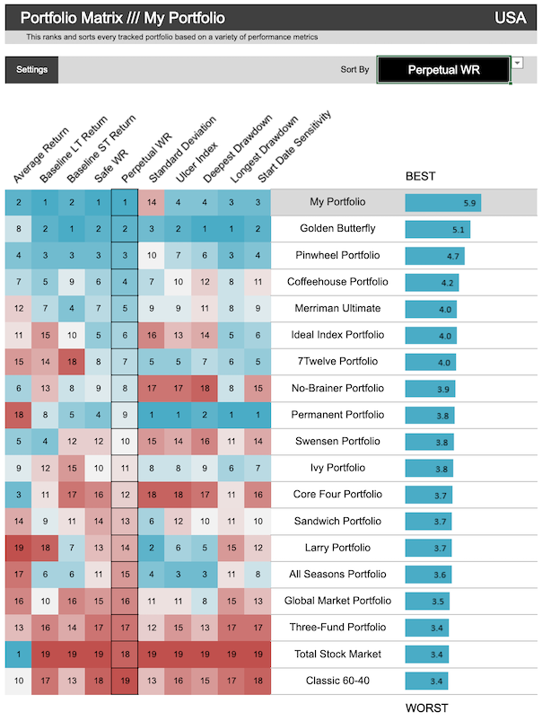

### New Portfolio - 2022 August

Playing around with portfolio allocations (see the [2022-08 notebooks here](../v2/)), I [found a new one](../v2/2022-08-07_refine_GB+REIT_allocations.ipynb) that I liked:
- 22% TSM (Total Stock Market)
- 23% SCV (Small-cap Value)
- 10% LTT (Long-term Treasuries)
- 25% REIT (Real Estate Investment Trust)
- 20% GLD (Gold)

Here are the updated stats using Simba spreadsheet Rev25c data through 2025
(the original search is in [this notebook](../v2/2022-08-07_refine_GB+REIT_allocations.ipynb)):

| assets                 | \|TSM\|SCV\|LTT\|Gold\|REIT\| |
| ---------------------- | ----------------------------- |
| percentages            | \|22%\|23%\|10%\|20%\|25%\|   |
| num\_assets            | 5                             |
| num\_years             | 54                            |
| avg\_return            | 0.077170                      |
| baseline\_lt\_return   | 0.064408                      |
| baseline\_st\_return   | -0.001783                     |
| pwr30                  | 0.056556                      |
| swr30                  | 0.065918                      |
| std\_dev               | 0.114828                      |
| ulcer\_score           | 3.568121                      |
| deepest\_drawdown      | -0.224203                     |
| longest\_drawdown      | 3                             |
| startdate\_sensitivity | 0.090436                      |
| pwr5                   | 0.011488                      |
| pwr10                  | 0.040242                      |
| pwr10\_stdev           | 0.013915                      |
| pwr10\_slope           | -0.027865                     |
| pwr30\_stdev           | 0.008044                      |
| pwr30\_slope           | -0.021094                     |

Adding 2022-2025 to the revised Rev25c history had the following isolated effects:

| Metric                     | Through 2021 | Through 2025 | Change        |
| -------------------------- | -----------: | -----------: | ------------: |
| Average Return             |        7.97% |        7.72% | -0.25 points  |
| Baseline Long-Term Return  |        6.44% |        6.44% | no change     |
| Baseline Short-Term Return |        3.45% |       -0.18% | -3.63 points  |
| Minimum 30-year PWR        |        5.66% |        5.66% | no change     |
| Minimum 30-year SWR        |        6.59% |        6.59% | no change     |
| Standard Deviation         |       11.11% |       11.48% | +0.37 points  |
| Ulcer Index                |         3.57 |         3.57 | no change     |
| Deepest Drawdown           |      -22.42% |      -22.42% | no change     |
| Start Date Sensitivity     |        8.95% |        9.04% | +0.09 points  |

The long-horizon minimum withdrawal rates and worst drawdown did not change because their
limiting historical periods occurred before 2022. The largest impact is on the short-term
baseline: the simultaneous real losses in stocks, long-term Treasuries, REITs, and gold during
2022 substantially weakened the latest short rolling window, despite the recovery in 2023-2025.

You can plug those numbers into the [PortfolioCharts.com](https://portfoliocharts.com/) tools:
- the [My Portfolio](https://portfoliocharts.com/portfolio/my-portfolio/) tool to see its stats 
([shortcode here](https://portfoliocharts.com/portfolio/my-portfolio/?shortcode=ZUSAXAA22AI23AK10AO25GB20Z))
- or the [Portfolio Matrix](https://portfoliocharts.com/portfolio/portfolio-matrix/)
to compare it against other portfolios
([shortcode here](https://portfoliocharts.com/portfolio/portfolio-matrix/?shortcode=ZUSAXAA22AI23AK10AO25GB20Z))
.

Here are some highlights vs. Golden Butterfly:

| Metrics                                             | New Portfolio | Golden Butterfly |
| --------------------------------------------------- | ------------: | ---------------: |
| Minimum 30-year PWR (Perpetual Withdrawal Rate) |          5.7% |             4.2% |
| Baseline Long-Term Return                           |          6.4% |             4.8% |
| Average Return                                      |          7.7% |             5.6% |
| Ulcer index                                         |           3.6 |              3.4 |

I wanted to explore alternatives to the Golden Butterfly portfolio with reduced exposure to Long-Term Treasuries
(see Ray Dalio's article: [Why in the World Would You Own Bonds When...](https://www.linkedin.com/pulse/why-world-would-you-own-bonds-when-ray-dalio/)).

I found REIT turned out to be a strong asset to include.

And surprisingly, this new portfolio entirely dropped the "cash" asset, STT (Short-term Treasuries),
yet its 10-year minimum PWR remains 4%, versus 2.1% for Golden Butterfly in the latest data.

Here are a few screenshots showing the new portfolio's performance:

The [Portfolio Matrix](https://portfoliocharts.com/portfolio/portfolio-matrix/?shortcode=ZUSAXAA22AI23AK10AO25GB20Z)
ranking the portfolios by Perpetual Withdrawal Rate:
> 

Its standard deviation ranking is lower, but I don't mind the increased volatility, 
especially when the ulcer score is still so low.

Here's a tall screenshot comparing the new portfolio on the left, to the Golden Butterfly portfolio on the right:
> Note the different y-axis scales in several graphs, their 
> differences are larger than they appear: Portfolio Growth, Rolling Returns, and Retirement Spending.
> 

[comment]: # (Command line to generate animated GIF:)
[comment]: # (  convert -delay 160 -loop 0 ?.png output.gif)

And [here's a tall animated GIF](portfoliocharts-compareNewVsGoldenButterfly_animation.gif) switching between the portfolios for easier comparison.
